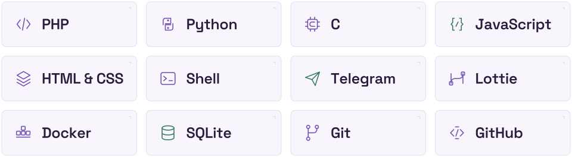

<picture>
  <source media="(max-width: 600px) and (prefers-color-scheme: dark)" srcset="assets/hero-mobile-dark.svg">
  <source media="(max-width: 600px)" srcset="assets/hero-mobile-light.svg">
  <source media="(prefers-color-scheme: dark)" srcset="assets/hero-dark.svg">
  
</picture>

 

**I build useful software, thoughtful tools, and things that move.** 
Open-source bots and digital products, shaped by code, design, and a little curiosity.

 

### Tools in the loop

<picture>
  <source media="(max-width: 600px) and (prefers-color-scheme: dark)" srcset="assets/toolbox-mobile-dark.svg">
  <source media="(max-width: 600px)" srcset="assets/toolbox-mobile-light.svg">
  <source media="(prefers-color-scheme: dark)" srcset="assets/toolbox-dark.svg">
  
</picture>

 

<picture>
  <source media="(prefers-color-scheme: dark)" srcset="assets/divider-dark.svg">
  
</picture>

### The loop, in numbers.

GitHub activity and repository statistics, refreshed daily.

<picture>
  <source media="(prefers-color-scheme: dark)" srcset="profile/stats-dark.svg">
  
</picture>
<picture>
  <source media="(prefers-color-scheme: dark)" srcset="profile/top-langs-dark.svg">
  
</picture>

<picture>
  <source media="(prefers-color-scheme: dark)" srcset="profile/metrics-dark.svg">
  
</picture>

  
Stats in text

[Read the current statistics, languages and activity as text](profile/summary.md).

 

<picture>
  <source media="(prefers-color-scheme: dark)" srcset="assets/footer-dark.svg">
  
</picture>

  
Credits & updates

Original Loop Lab artwork created for this profile with OpenAI image generation. Typography: [Space Grotesk](https://github.com/floriankarsten/space-grotesk), with its [SIL Open Font License](assets/fonts/OFL-SpaceGrotesk.txt). Tool symbols are original geometric illustrations.

Data: [GitHub Readme Stats](https://github.com/stats-organization/github-readme-stats-action) and [lowlighter/metrics](https://github.com/lowlighter/metrics). Local SVG workflow inspired by [david-lev](https://github.com/david-lev/david-lev). Language percentages describe repository content, not proficiency. The calendar may include private contribution totals; activity entries are public.

Updated daily at 03:37 UTC, or manually from **Actions → Update profile metrics → Run workflow**. Uses the existing `METRICS_TOKEN` and automatic `GITHUB_TOKEN`; no additional account, hosting service, or paid integration is required. Failed updates retain the last valid output, and unchanged data creates no commit.

